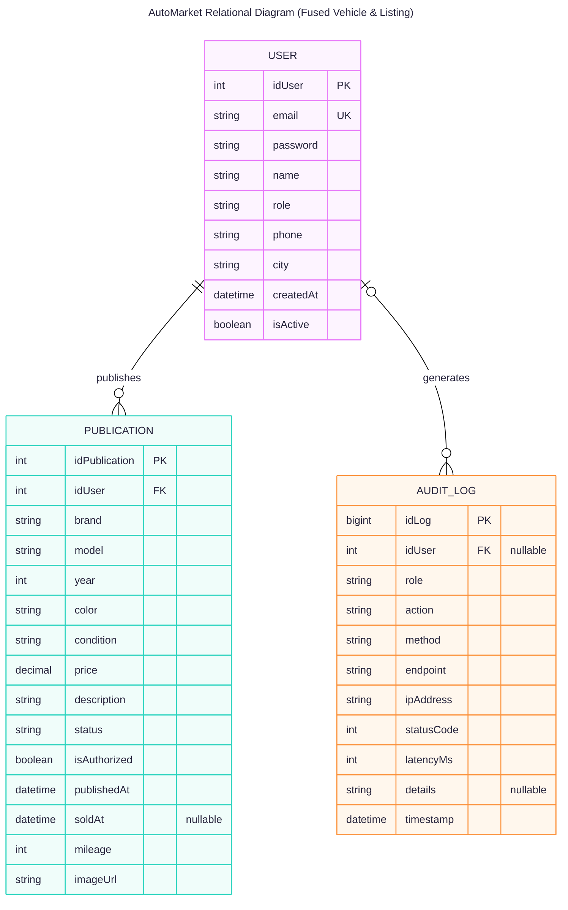

# AutoMarket - Workshop

AutoMarket es una plataforma web para la comercialización de vehículos usados desarrollada en **Go** sobre el framework **Gin**. El proyecto implementa un esquema integral de seguridad basado en el modelo **AAA (Authentication, Authorization, Auditing)** utilizando exclusivamente las librerías nativas del lenguaje, garantizando un control granular de acceso y trazabilidad sin dependencias externas de seguridad.

---

## Objetivo de Seguridad: Modelo AAA con Librerías Nativas

El núcleo del taller consiste en diseñar e integrar un ecosistema de seguridad autónomo y desacoplado de suites de terceros (como librerías externas de JWT u OAuth):

* **Authentication (Autenticación):** Emisión y validación de tokens de sesión firmados criptográficamente mediante hashes simétricos **HMAC-SHA256**. El mecanismo codifica el payload en base64 URL-safe, verifica la integridad y valida la expiración temporal de forma determinista.
* **Authorization (Autorización - RBAC):** Control de acceso basado en roles (**Admin**, **Seller**) ejecutado mediante middlewares interceptores en Gin. Cada solicitud es evaluada contra los permisos requeridos por la ruta antes de despachar el controlador.
* **Auditing (Auditoría):** Captura y persistencia de trazas operativas no bloqueantes (`sync.RWMutex` / estructuras en memoria y logs estándar). Se audita quién ejecuta la acción, el recurso accedido, el método HTTP, la dirección IP de origen, el código de estado retornado y la latencia de respuesta.

---

## Modelo Relacional y Entidades

El dominio de datos unifica las especificaciones mecánicas del vehículo, la fotografía del automotor (`imageUrl`) y las condiciones comerciales de la oferta en una sola entidad de publicación (`PUBLICATION`), vinculando al vendedor (`USER`) y los registros de trazabilidad de seguridad (`AUDIT_LOG`).



### Descripción de Entidades

* **`USER`**: Almacena las credenciales de acceso (`email`, `password`), información del perfil (`name`, `phone`, `city`), fecha de creación (`createdAt`), estado activo (`isActive`) y rol asignado (`role`: Admin, Seller) para el control de acceso basado en roles (RBAC).
* **`PUBLICATION`**: Modelo consolidado con clave primaria `idPublication` que unifica las propiedades físicas del vehículo (`brand`, `model`, `year`, `color`, `condition`, `mileage`), la imagen asociada (`imageUrl`) y las condiciones del mercado (`price`, `description`, `status`, `isAuthorized`, `publishedAt`, `soldAt`), vinculado al vendedor (`idUser`).
* **`AUDIT_LOG`**: Registro inmutable de trazabilidad y eventos de seguridad del modelo AAA. Captura al usuario ejecutor (`idUser` nullable para eventos anónimos o no autenticados), rol (`role`), acción ejecutada (`action`, `method`, `endpoint`), dirección IP (`ipAddress`), telemetría de respuesta (`statusCode`, `latencyMs`), metadatos contextuales (`details`) y marca de tiempo (`timestamp`).

#### Relaciones del Modelo

* **`USER ||--o{ PUBLICATION`**: Un usuario puede crear y publicar múltiples ofertas de vehículos.
* **`USER |o--o{ AUDIT_LOG`**: Un usuario genera registros de auditoría al interactuar con el sistema (relación opcional en el extremo del usuario para registrar también acciones no autenticadas).

---

## Arquitectura del Proyecto

El código está estructurado bajo una arquitectura por capas (*Layered Architecture*) siguiendo las convenciones de organización de Go:

```plaintext
marketplace/
├── cmd/
│   └── server/
│       └── main.go              # Punto de entrada. Inicializa Gin y arranca el servidor.
├── data/                        # Persistencia local en archivos JSON (Runtime)
│   ├── .gitkeep                 
├── internal/
│   ├── models/                  # Entidades de dominio y definiciones de structs
│   │   ├── user.go              # Entidad User y roles (Admin, Seller)
│   │   ├── publication.go       # Entidad Publication y especificaciones del vehículo
│   │   └── audit_log.go         # Entidad AuditLog para trazabilidad AAA
│   │
│   ├── handlers/                # Controladores HTTP de Gin (Transporte)
│   │   ├── user_handler.go      # Handlers de autenticación y usuarios
│   │   └── car_handler.go       # Handlers de vehículos y publicaciones
│   │
│   ├── middleware/              # Interceptores del modelo AAA
│   │   ├── auth.go              # Validación criptográfica de tokens nativos
│   │   ├── rbac.go              # Verificación de roles permitidos
│   │   └── audit.go             # Captura y almacenamiento de registros de auditoría
│   │
│   ├── services/                # Casos de uso y reglas de negocio puras
│   │   ├── user_service.go      # Lógica de registro, emisión de credenciales y permisos
│   │   └── car_service.go       # Flujo de publicación, moderación y venta
│   │
│   └── repositories/            # Capa de persistencia (Operaciones sobre archivos JSON)
│       ├── user_repo.go         # Lectura y escritura sobre data/user.json
│       └── car_repo.go          # Lectura y escritura sobre publicaciones e imágenes
│
├── pkg/                         # Módulos transversales desacoplados del dominio
│   ├── database/                # Helpers de persistencia, I/O y bloqueo concurrente
│   ├── response/
│   │   └── http_response.go     # Formato estándar de respuestas JSON
│   └── security/                # Utilidades de seguridad criptográfica nativa (AAA)
│       └── password.go          # Hash seguro con salt aleatorio (SHA-256)
│
├── web/                         # Vistas y assets estáticos (SSR con Gin)
│   ├── static/                  # Archivos estáticos
│   │   ├── css/                 # Hojas de estilo CSS (main.css)
│   │   └── uploads/             # Almacenamiento local de imágenes de los autos
│   └── templates/               # Plantillas HTML procesadas por el motor web (.html)
│
├── config/
│   └── config.go                # Constantes y configuración interna del proyecto
│
├── go.mod
└── go.sum
```

---

## Puesta en Marcha (Cómo correr el proyecto)

### Prerrequisitos

* **Go**: Versión 1.22 o superior instalada.
* **Persistencia sin base de datos externa**: Por requerimientos del taller no se utilizan dependencias externas más allá del framework **Gin**. El almacenamiento y persistencia de datos se gestiona directamente en archivos JSON dentro del directorio `data/` (`user.json`, etc.) empleando las librerías estándar de Go (`encoding/json`, `os`, `sync`).

### Pasos de Ejecución

1. **Clonar el repositorio:**
   ```bash
   git clone <URL_DEL_REPOSITORIO>
   cd marketplace
   ```

2. **Descargar dependencias:**
   ```bash
   go mod download
   ```

3. **Ejecutar el servidor:**
   ```bash
   go run cmd/server/main.go
   ```

4. **Acceso al servicio:**
   El servicio estará disponible en `http://localhost:8080`.

---

## Declaración de Uso Responsable de Inteligencia Artificial

En concordancia con los lineamientos de integridad académica y transparencia técnica establecidos por el **Institute of Electrical and Electronics Engineers (IEEE)** y la **Association for Computing Machinery (ACM)**, se declara el uso de herramientas de Inteligencia Artificial Generativa basadas en Modelos de Lenguaje Grande (LLMs) durante el ciclo de vida del proyecto.

Dichas herramientas se emplearon como asistencia técnica para:
* La formulación, contraste y evaluación comparativa de decisiones de diseño de arquitectura de software y modelado relacional.
* La asistencia en la sintaxis, estructuración de handlers, diseño de middlewares AAA y optimización de fragmentos de código fuente en Go.
* El apoyo en la redacción, estructuración y estandarización técnica de la presente documentación.

> **Compromiso de auditoría:** Los autores ratifican que los sistemas de IA carecen de estatus de autoría. Todo el código fuente, esquemas relacionales y decisiones de seguridad fueron revisados, probados, auditados e integrados manualmente por el equipo de desarrollo, asumiendo la total responsabilidad por el funcionamiento, calidad y seguridad de la solución.

---

## Contribuyentes y Créditos

* **Equipo de Desarrollo del Taller:** Estudiantes de la asignatura de Ciberseguridad / Ingeniería de Sistemas.

---

## Licencia

Este proyecto está distribuido bajo la licencia MIT. Para conocer los términos y condiciones de uso, copia, modificación y distribución, consulte el archivo [LICENSE](LICENSE) ubicado en la raíz del repositorio.