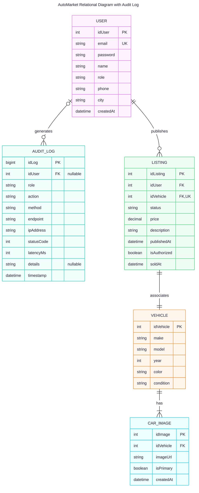

# AutoMarket - Workshop

AutoMarket es una plataforma web para la comercialización de vehículos usados desarrollada en **Go** sobre el framework **Gin**. El proyecto implementa un esquema integral de seguridad basado en el modelo **AAA (Authentication, Authorization, Auditing)** utilizando exclusivamente las librerías nativas del lenguaje, garantizando un control granular de acceso y trazabilidad sin dependencias externas de seguridad.

---

## Objetivo de Seguridad: Modelo AAA con Librerías Nativas

El núcleo del taller consiste en diseñar e integrar un ecosistema de seguridad autónomo y desacoplado de suites de terceros (como librerías externas de JWT u OAuth):

* **Authentication (Autenticación):** Emisión y validación de tokens de sesión firmados criptográficamente mediante hashes simétricos **HMAC-SHA256**. El mecanismo codifica el payload en base64 URL-safe, verifica la integridad y valida la expiración temporal de forma determinista.
* **Authorization (Autorización - RBAC):** Control de acceso basado en roles (**Admin**, **Vendedor**) ejecutado mediante middlewares interceptores en Gin. Cada solicitud es evaluada contra los permisos requeridos por la ruta antes de despachar el controlador.
* **Auditing (Auditoría):** Captura y persistencia de trazas operativas no bloqueantes (`sync.RWMutex` / estructuras en memoria y logs estándar). Se audita quién ejecuta la acción, el recurso accedido, el método HTTP, la dirección IP de origen, el código de estado retornado y la latencia de respuesta.

---

## Modelo Relacional y Entidades

El dominio de datos separa estrictamente las propiedades físicas del automóvil de las condiciones comerciales de la oferta publicitaria.



### Descripción de Entidades

* **`USER`**: Almacena las credenciales de acceso (`email`, `password`), datos de contacto y perfil (`name`, `phone`, `city`), fecha de creación (`createdAt`) y rol asignado (`role`: Admin, Vendedor) para la resolución de políticas RBAC.
* **`VEHICLE`**: Contiene las especificaciones técnicas, físicas y mecánicas del automóvil (`make`, `model`, `year`, `color`, `condition`).
* **`CAR_IMAGE`**: Gestiona las imágenes multimedia asociadas a cada vehículo (`idVehicle`), registrando la URL (`imageUrl`), el indicador de imagen principal (`isPrimary`) y la fecha de subida (`createdAt`).
* **`LISTING`**: Representa el anuncio comercial en la plataforma. Vincula de forma exclusiva al vendedor (`idUser`) con el vehículo ofertado (`idVehicle`), centralizando el precio (`price`), estado de publicación (`status`), descripción (`description`), fecha de publicación (`publishedAt`), aprobación administrativa (`isAuthorized`) y cierre de venta (`soldAt`).
* **`AUDIT_LOG`**: Centraliza el registro inmutable de trazabilidad y auditoría del modelo AAA. Almacena las operaciones de los usuarios (con `idUser` nullable para peticiones no autenticadas o fallidas), rol (`role`), acción ejecutada (`action`, `method`, `endpoint`), dirección IP (`ipAddress`), telemetría de respuesta (`statusCode`, `latencyMs`), metadatos adicionales (`details`) y marca de tiempo (`timestamp`).

---

## Arquitectura del Proyecto

El código está estructurado bajo una arquitectura por capas (*Layered Architecture*) siguiendo las convenciones de organización de Go:

```plaintext
marketplace/
├── cmd/
│   └── server/
│       └── main.go              # Punto de entrada. Inicializa Gin, la DB y arranca el servidor.
├── internal/
│   ├── models/                  # Entidades de dominio y definiciones de structs
│   │   ├── user.go              # Entidad User y roles (Admin, Vendedor, Cliente)
│   │   └── car.go               # Entidad Vehicle y Listing
│   │
│   ├── handlers/                # Controladores HTTP de Gin (Transporte)
│   │   ├── user_handler.go      # Handlers de autenticación y usuarios
│   │   └── car_handler.go       # Handlers de vehículos y publicaciones
│   │
│   ├── middleware/              # Interceptores del modelo AAA
│   │   ├── auth.go              # Validación criptográfica de tokens nativos
│   │   ├── rbac.go              # Verificación de roles permitidos
│   │   └── audit.go             # Captura y almacenamiento de registros de auditoría
│   │
│   ├── services/                # Casos de uso y reglas de negocio puras
│   │   ├── user_service.go      # Lógica de registro, emisión de credenciales y permisos
│   │   └── car_service.go       # Flujo de publicación, moderación y venta
│   │
│   └── repositories/            # Capa de persistencia y consultas SQL
│       ├── user_repo.go         # Operaciones SQL sobre la tabla User
│       └── car_repo.go          # Operaciones SQL sobre Vehicle y Listing
│
├── pkg/                         # Módulos transversales desacoplados del dominio
│   ├── database/
│   │   └── connection.go        # Gestión del pool de conexiones SQL
│   └── response/
│       └── http_response.go     # Formato estándar de respuestas JSON
│
├── web/                         # Vistas y assets estáticos (SSR con Gin)
│   ├── static/                  # Hojas de estilo CSS, JS e imágenes
│   └── templates/               # Plantillas HTML procesadas por el motor web
│
├── config/
│   └── config.go                # Carga de configuración y variables de entorno
│
├── go.mod
└── go.sum
```

---

## Puesta en Marcha (Cómo correr el proyecto)

### Prerrequisitos

* **Go**: Versión 1.22 o superior instalada.
* **Base de datos**: Servidor de base de datos relacional (PostgreSQL / MySQL) configurado y accesible.

### Pasos de Ejecución

1. **Clonar el repositorio:**
   ```bash
   git clone <URL_DEL_REPOSITORIO>
   cd marketplace
   ```

2. **Descargar dependencias:**
   ```bash
   go mod download
   ```

3. **Configurar variables de entorno:**
   Cree un archivo `.env` en la raíz del proyecto tomando como base los parámetros requeridos por `config/config.go`:
   ```env
   PORT=8080
   DB_HOST=localhost
   DB_PORT=5432
   DB_USER=postgres
   DB_PASSWORD=secret
   DB_NAME=automarket_db
   AUTH_SECRET_KEY=clave_secreta_para_firmas_hmac_sha256
   ```

4. **Ejecutar el servidor:**
   ```bash
   go run cmd/server/main.go
   ```

5. **Acceso al servicio:**
   El servicio estará disponible en `http://localhost:8080`.

---

## Declaración de Uso Responsable de Inteligencia Artificial

En concordancia con los lineamientos de integridad académica y transparencia técnica establecidos por el **Institute of Electrical and Electronics Engineers (IEEE)** y la **Association for Computing Machinery (ACM)**, se declara el uso de herramientas de Inteligencia Artificial Generativa basadas en Modelos de Lenguaje Grande (LLMs) durante el ciclo de vida del proyecto.

Dichas herramientas se emplearon como asistencia técnica para:
* La formulación, contraste y evaluación comparativa de decisiones de diseño de arquitectura de software y modelado relacional.
* La asistencia en la sintaxis, estructuración de handlers, diseño de middlewares AAA y optimización de fragmentos de código fuente en Go.
* El apoyo en la redacción, estructuración y estandarización técnica de la presente documentación.

> **Compromiso de auditoría:** Los autores ratifican que los sistemas de IA carecen de estatus de autoría. Todo el código fuente, esquemas relacionales y decisiones de seguridad fueron revisados, probados, auditados e integrados manualmente por el equipo de desarrollo, asumiendo la total responsabilidad por el funcionamiento, calidad y seguridad de la solución.

---

## Contribuyentes y Créditos

* **Equipo de Desarrollo del Taller:** Estudiantes de la asignatura de Ciberseguridad / Ingeniería de Sistemas.

---

## Licencia

Este proyecto está distribuido bajo la licencia MIT. Para conocer los términos y condiciones de uso, copia, modificación y distribución, consulte el archivo [LICENSE](LICENSE) ubicado en la raíz del repositorio.